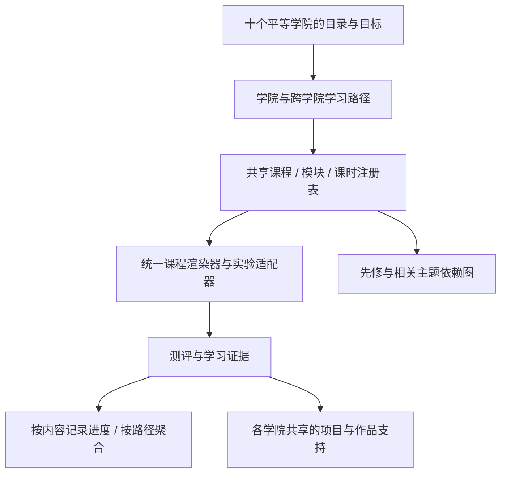

# Technical Architecture v1

## Stack recommendation

pnpm workspace monorepo; TypeScript; React + Vite for lightweight PWA MVP, React Router, TanStack Query, Tailwind or CSS variables (choose one styling approach), Zod input schemas, Vitest + Testing Library, Playwright smoke E2E. Server API: Cloudflare Workers (Hono optional) OR conventional Node server, select one based on deployment constraints. Database: managed PostgreSQL for users/progress/project metadata when needed; anonymous/local onboarding stored locally before account creation. Storage: object store for user projects. Avoid microservices in MVP. Server-side OpenAI-compatible provider adapters must be modular and vendor-neutral.

## Monorepo

apps/web; apps/api; packages/ui; packages/core; packages/content-schema; packages/lesson-engine; packages/lab-contracts; packages/ai-gateway; packages/integrations; content/academy-{10 slugs}; docs; tests.

## Key domain entities

User(id, locale, settings); Academy(id, slug, title); Course(id, academyId, level, status); Module(id, courseId, order); Lesson(id, moduleId, contentVersion); Enrollment(userId, courseId); LessonProgress(userId, lessonId, mastery, lastActiveAt); Lab(id, runtimeKind, deviceRequirement); LabAttempt(id, userId, labId, evidence, result); Project(id, ownerId, visibility, templateId); ProjectVersion(id, projectId, commitRef); MentorConversation(id, userId, lessonId); AIUsage(id, userId, provider, tokensIn, tokensOut, billedEstimate); IntegrationConnection(id, userId, provider, scopes, encryptedCredentialsRef).

## Architecture boundaries

UI depends on domain contracts, never on concrete AI or GitHub SDK. Lab engine is plugin-based: lesson references `labId`; runtime adapter owns capability check, run, reset, evaluate. Integrations execute only server-side with explicit OAuth scopes and consent. Separate tutorial mock/simulated actions from real APIs. Treat external repositories, web pages, imported files, and AI outputs as untrusted data. Do not inject untrusted HTML. Restrict file and network access for executable code.

## Routes / endpoints

GET `/api/catalog`; GET `/api/course/:id`; GET `/api/lesson/:id`; POST `/api/progress`; POST `/api/lab/attempt`; POST `/api/mentor/chat` (authenticated + quota); GET `/api/mentor/usage`; GET `/api/opensource/repository?owner=&repo=` (public metadata rate limited; allowlist/safe URL parsing); POST `/api/projects`; GET `/api/projects`; POST `/api/integrations/google/connect` (OAuth initiation); POST `/api/integrations/google/disconnect`.

## Isolation

Frontend JS sandbox: iframe sandbox with CSP, restricted origin, resource budgets. Python via Pyodide worker for curated examples; no fake arbitrary Python support. Remote execution for other languages only in hardened isolated services with caps, or marked unavailable. Never execute arbitrary GitHub repos in the API worker. Local device model feature detected and opt-in. Secret scanning and branch protection before public launch.

## Data and auth

Anonymous try-first experience; account optional until syncing projects; OAuth/credential flows isolated. Per-user access enforcement server-side (not only front-end), least privilege, audit log for external writes. Save user data only as needed; export/delete paths. No plaintext API keys stored; server secrets or encryption-backed vault. RBAC: learner, author, admin.

## Course content pipeline

Stable content IDs. MDX (curated/sanitized and built at compile time) or structured JSON; ensure no arbitrary user-defined JSX. Schema check before publishing. Localization by message IDs with English terms preserved alongside Chinese explanation. Content authored/reviewed versioned; evidence that labs validate learning objectives.

## PWA

Static assets and reading materials cached; never cache sensitive API responses or auth tokens. Offline lab flags per runtime. Desktop has advanced split-view; mobile uses single pane. Low-powered device detect WebGPU rather than assuming.

## CI and quality gates

pnpm lint; pnpm typecheck; pnpm test; pnpm build; pnpm test:e2e smoke. Dependency auditing, accessibility automated checks, and manual mobile QA. PR rules: no secrets, no unrelated file edits, lockfile updates reviewed, responsive screenshots for UI changes, source attribution for open-source reused content.

## Milestone definition of done

Working path demonstrated; empty/loading/error/offline states; mobile basic usability; accessible keyboard controls; typed contracts, tests for changed behavior, docs updated, no console errors, Git commit and concise status report.

## v2 架构决策：十个平等学院与共享课程图

本节替代上文中 `Course(id, academyId, ...)` 的单学院所有权假设。上面的技术栈、实体和路由清单包含目标架构，并不表示已全部实现；实际部署使用 React/Vite + Node 24/SQLite，现状以 CURRENT_STATUS 为准。本节记录领域设计；Phase 5 已实现的具体契约与迁移见文末，字段以 packages/curriculum/schema.ts 为准。

### 分层与职责

学院组织内容，不拥有一套独立引擎。所有十个现有学院 ID 保持不变。学院名称不得出现在核心引擎的特殊授权、功能开关或默认课程选择逻辑里。功能可用性取决于内容发布状态、实验能力与权限，而不是学院排名。

### 建议的领域契约

| 实体                                  | 核心字段与关系                                                                                                                 |
| ------------------------------------- | ------------------------------------------------------------------------------------------------------------------------------ |
| `Academy`                             | `id`, `slug`, `title`, `description`, `pathIds`；十个平等目录项                                                                |
| `Topic`                               | `id`, `title`, `outcomes`, `resourceRefs`；跨学院概念标签，不与课时 ID 混用                                                    |
| `LearningPath`                        | `id`, `academyIds[]`, `outcomes`, `courseRefs[]`, `projectRefs[]`                                                              |
| `Course`                              | `id`, `version`, `status`, `outcomes`, `moduleRefs[]`, `assessmentRefs[]`, `completionRule`, `projectRefs[]`；可被多条路径引用 |
| `Module`                              | `id`, `outcomes`, `lessonRefs[]`, `assessmentRefs[]`                                                                           |
| `Lesson`                              | 保留现有 ID，增加通用的 `topicIds[]`、内容段/互动块、`labRefs[]`、`assessmentRefs[]`；内容独立于 React 组件                    |
| `ContentRef`                          | `kind`, `id`, `compatibleVersion`；指定被引用对象和兼容版本，避免发布后静默改变学习要求                                        |
| `Dependency`                          | `fromRef`, `toRef`, `kind: required/recommended/related`, `rationale`；from 是当前学习项，to 是其先修或相关项                  |
| `Assessment`                          | `id`, `version`, `rubric`, `passRule`, `evidenceRequirements`, `feedback`                                                      |
| `ProgressEvidence`                    | `learnerId`, `contentId`, `contentVersion`, `assessmentVersion?`, `state`, `evidenceRefs[]`, `updatedAt`                       |
| `ProjectTemplate` / `ProjectEvidence` | 模板 ID、目标、量规、里程碑、内容引用；学习者实例默认私有，按真实保存能力披露本机/服务器位置                                   |

学院归属通过路径与引用表达；同一课程可以出现在多个学院下。不要将学院 ID 拼入新进度主键，造成共享内容多份完成记录。现有带 `os-` 前缀的 ID 仍是合法稳定 ID，不为了命名美观重命名。

### 共享主题与引用示例

以下 ID 是设计示例，尚不是已发布课程或运行时注册项：

| 共享主题                 | 可引用它的路径示例                    | 不复制的内容                            |
| ------------------------ | ------------------------------------- | --------------------------------------- |
| `topic.git`              | 游戏开发、网站与云端、开源、编程      | 版本控制概念、暂存/提交课时与实验适配器 |
| `topic.github`           | 编程、开源、人工智能项目协作          | 仓库导航、协作流程、授权与安全知识      |
| `topic.python`           | 编程、人工智能、机器人与物联网        | 变量、循环、函数与 Pyodide 运行适配器   |
| `topic.apis`             | Workspace、网站与云端、机器人与物联网 | 请求/响应、鉴权和数据处理基础           |
| `topic.cloud-deployment` | 游戏、网站与云端、人工智能项目        | 构建产物、环境变量、部署与运行验证      |

可为同一主题编写游戏版本发布、机器人数据处理等不同练习，前提是它们有独立学习目标/量规，并引用同一基础课时，不复制整份源内容。主题与学院是多对多关系；并非每条路径都必须经过这些技术主题。

### 图的验证与学习行为

注册表先做 Zod 结构校验，再做跨对象引用和图校验：ID 唯一、引用存在、版本兼容、必需/推荐先修子图无环（忽略 `related` 边）。同一个共享节点可被多个父路径引用，这是复用，不是循环。检查课程/模块展开后的依赖，防止包含关系掩盖循环。

依赖解析器返回有序学习项、已满足证据、未满足的必需项与原因。推荐先修可跳过；相关主题仅提供链接。发布 `available` 内容时，其硬性先修必须可完成，或提供明确可验证的等效证据方案；不能让学习者卡在规划中节点。不得把“来自其他学院”当作拒绝访问的理由。

同一共享课时通过一次即可在兼容路径中满足相同要求；课程/路径进度按唯一的必需引用及量规聚合，选修项和重复引用不增加分母。各路径独有项目仍需各自完成，不能用共享概念课通过记录冒充项目成果。版本不兼容时保留旧证据，提示新要求；不可静默撤销已获成果。

### 接口、渲染和教学上下文

`packages/lesson-engine` 应仅依赖通用契约及注册表查询接口，不能直接导入 `content/opensource.ts`。现有课时组件中的仓库浏览示例应成为可注册的互动块，而非渲染器内 `lessonId === 'os-source'` 的专用分支。Python 和公式练习保留运行时能力，逐步通过共同实验/测评契约接入。

所有 `/learn/:academy` 和课程页面通过同一目录与路径解析器生成。保留 `/learn/opensource/foundations`、`/learn/opensource/assessment`、`/lesson/:lessonId` 与现有实验 URL；将其适配到共同查询接口，不删除旧链接。可追加路径上下文来决定“返回路径”，不能复制课时或进度。项目入口按当前路径查询模板和证据，不能只识别开源工作表。

服务端进度校验、课程查询、Mentor 上下文与回退内容改为查询同一注册表；保留认证、租户隔离、发布/访问权限和预算校验。无课程上下文时采用通用学习帮助，不能默认用开源第一课回答其他方向。注册表增加主题引用，不赋予任意 URL、文件或代码执行权限。

### 数据兼容与渐进迁移

1. 首先用适配器将现有课程、实验和内容挂到注册表。保留所有旧 ID、路由、内容文件和默认数据，避免边抽象边重写课程。
2. 为现有 `nexus-progress` v1 记录提供兼容读取；升级写入前备份原始数据并验证新模式，失败时保留原数据。旧 `completed` 条目映射为相同课时的完成证据；缺少历史时间/量规版本时标明未知，不伪造精度或认定整条路径已通过。
3. 保留 `nexus-goal`、`nexus-worksheet`、`nexus-lab-*` 和 `nexus-python-*` 的已有本机记录。逐步用证据适配器索引这些成果；旧记录没有足够上下文时不推定新的项目完成状态。
4. 服务端先兼容 v1 同步请求，再支持新模式；通过事务与幂等迁移处理 SQLite 记录。先更新课程 ID 校验，再导入跨学院进度；禁止用仅含开源 ID 的白名单过滤新课程证据。临时未识别的记录应安全保留待解析，不能静默丢弃；写入仍校验已发布且有权访问的内容，不能接受任意客户端完成声明。
5. 同步合并按内容 ID、版本与证据规则处理，不按学院重置或复制记录。共享设备显式合并、账号隔离、删除语义与匿名费用账本保持原有边界。
6. 迁移前后验证旧用户续学、重访、工作表、实验记录、账号同步及 Mentor 回退。完成后再切换首页和路径聚合默认值；不得清空本机或数据库来让新模式通过测试。

### 验收与实现范围

Phase 5 已实现注册表、图解析/校验、通用课程组件、跨路径证据聚合及兼容迁移测试。验收应覆盖十个学院同级入口、规划课程无虚假开始动作、至少两条不同学院路径复用同一节点且进度只记一次、循环/悬空引用拒绝、旧 URL/ID/学习证据兼容，以及原有功能全量回归。

## Phase 5 运行时实现

- 权威内容入口为 `content/curriculum.ts`，新模块作者内容在 `content/starter-curriculum.ts`。`packages/curriculum/schema.ts` 定义九类实体（含 Lab）、发布状态及 Zod 互动联合类型。LearningPath 在存储中使用 kind `path`，ProjectTemplate 使用 `project`。
- `ContentRef` 实际字段为 kind/id/version，version 是确切正整数，不是宽松 semver 范围；证据主键为 kind:id@version。引用版本不一致启动即拒绝。升级内容时旧证据保留在 unresolved，不能静默换算成新版本完成。
- `registry.ts` 检查重复身份、缺失/错版本、不可完成的发布容器、无解互动、required/recommended 循环。展开容器参与环检测；academy/path 归属不作为先修边。required 阻止授予完成，recommended 提示，related 不锁课。Topic/Academy 不可作为要求完成的先修。
- `evidence.ts` 提供共同量规、证据验证与唯一引用聚合。课时完成要求互动和测验同时通过；独立 Assessment 证据不冒充课时完成。共享 API 课时供三个路径复用，Git 与证据辨析各供两个路径复用；课程项目仍要求各自课程全部指定课时。
- `/course/:courseId`、`/lesson/:lessonId?course=...`、`/assessment/:assessmentId` 使用懒加载通用学习界面；旧 M01 URL/ID 不变。移动标签保持练习状态，桌面展示完整工作区。
- `curriculum-storage.ts` 首次升级先保存旧键原始字节到 `nexus-curriculum-backup-v1`，再写独立 `nexus-curriculum-progress` v2。旧键不重写；未知 ID、错版本和损坏 JSON 保留待解析。存储失败不覆盖原始数据。
- SQLite `progress_backups` 在事务内备份旧 progress 行；`/api/progress` 保留旧六课协议，`/api/progress/v2` 重新验证证据并按账号合并。只读 `/api/curriculum`、课程、课时接口查询同一注册表。显式删除账号同时删除学习备份。
- Mentor 的服务器与非生成式回退从共同课时上下文读取。认证、预算、平台密钥仅服务端边界不变。Pages 使用编译时目录、本机证据和非生成式帮助，不调用后端。
- Pyodide 程序从 `content/python.ts` 构建到本地 `python-programs.json`，worker 与课程期望引用同一精选程序源；运行时仍按需加载，不新增包下载或任意服务端执行。

浏览器实验凭据是低风险自学证据，不是防作弊认证。服务器重新检查提交的量规与输出格式，不声称能密码学证明客户端真实执行。当前项目卡片由课程证据聚合并可导出，不是独立云项目编辑器。发布清单与执行/模型边界见 CONTENT_INVENTORY。
